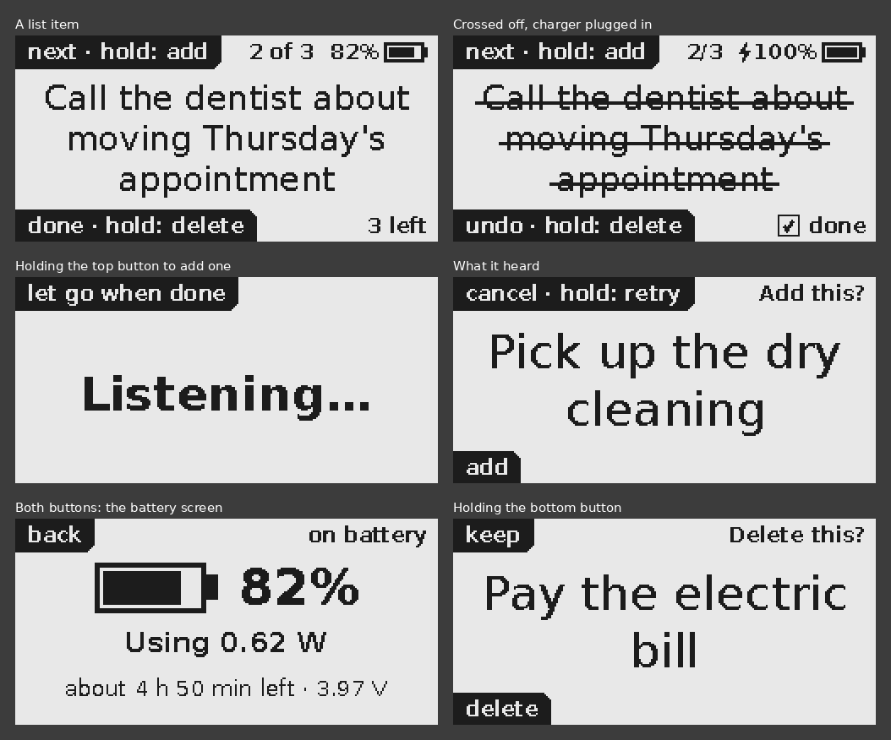

# eink-todo-device

This is a Raspberry Pi based to-do list device, meant to be used with an Adafruit
e-ink hat and an I2S microphone. The device will transcribe spoken to-do list items
into a list, display one item at a time, and allows you to cross off items and/or
remove them.

It runs on a Raspberry Pi Zero 2 W with Adafruit's 2.13" e-ink bonnet, using just the
bonnet's two buttons, which sit one above the other at the left edge of the screen.
What each button does right now is printed in the screen corner next to it. Speech is
turned into text on the Pi itself (Moonshine's Tiny Streaming model), so nothing is
sent anywhere.



## Parts

- Raspberry Pi Zero 2 W with a 2x20 header soldered on
- Adafruit 2.13" Monochrome E-Ink Bonnet, product 4687 (plugs onto the header)
- An **I2S** MEMS microphone breakout (INMP441, ICS-43434 or SPH0645), wired to the
  header. A USB microphone on a micro-USB OTG adapter also works, with no wiring.
- Optional: Waveshare UPS HAT (C) underneath for battery power. The app shows its
  battery level and power use.

Note the S: I2S is the digital audio connection these mics use. I2C is a different
bus. The MAX4466 won't work at all, because the Pi has no analog inputs.

## Wiring

- **Bonnet:** press it onto the header. It uses SPI plus GPIO 17, 22 and 27. Its
  buttons are on GPIO 6 (the top one, labelled in the screen's top-left corner) and
  GPIO 5 (the bottom one, labelled in the bottom-left corner).
- **I2S microphone:**

  | Mic pin (names vary) | Pi pin |
  |---|---|
  | VDD / 3V | pin 1 (3.3 V). Not 5 V. |
  | GND | pin 39 (or any ground pin) |
  | SCK / BCLK | pin 12 (GPIO 18) |
  | WS / LRCL | pin 35 (GPIO 19) |
  | SD / DOUT | pin 38 (GPIO 20) |
  | L/R / SEL | any ground pin, or the mic's own GND pin. Don't leave it unconnected. |

  None of these pins are used by the bonnet or the UPS HAT (which uses only power and
  GPIO 2 and 3). The bonnet covers the header, so solder the wires to the pins from
  underneath. If the UPS HAT goes under the Pi, route the wires out the side and
  check the UPS still sits flat with its spring pins touching.
- **UPS HAT (C):** it sits under the Pi and needs nothing else wired. Its battery
  monitor talks to the Pi over I2C on GPIO 2 and 3.

## Setup

Flash **Raspberry Pi OS Lite (64-bit)** with Raspberry Pi Imager (turn on SSH and
Wi-Fi there), then on the Pi:

```bash
sudo apt update
sudo apt install -y git python3-venv python3-pil python3-libgpiod libgpiod-dev fonts-dejavu-core libportaudio2
sudo raspi-config nonint do_spi 0
sudo raspi-config nonint do_i2c 0
echo "dtoverlay=spi0-0cs" | sudo tee -a /boot/firmware/config.txt
echo "dtoverlay=googlevoicehat-soundcard" | sudo tee -a /boot/firmware/config.txt
sudo reboot
```

The `spi0-0cs` line stops Linux from claiming GPIO 8, the display's chip-select pin,
which the Adafruit library drives itself. Without it you get a "GPIO busy" error.
Adafruit's own SPI script writes the same line. The `googlevoicehat-soundcard` line
turns the I2S microphone into a sound card; it's the setting Adafruit's I2S mic guide
uses. (Skip it if you use a USB mic.) `do_i2c` turns on I2C, which the app uses to
read the UPS HAT's battery level.

After the reboot, check the microphone. `arecord -l` should list a "googlevoicehat"
card; note its card number. Then, using that number in place of `1`:

```bash
arecord -D plughw:1 -c1 -r 48000 -f S32_LE -V mono -d 10 /dev/null
```

Talk while it runs: the bar it draws should jump. If it stays flat, check the wiring.

Then install the app:

```bash
git clone https://github.com/profdlieberman/eink-todo-device.git ~/todo
python3 -m venv --system-site-packages ~/todo-env
~/todo-env/bin/pip install adafruit-blinka adafruit-circuitpython-epd moonshine-voice
~/todo-env/bin/python ~/todo/todo.py --download    # once, needs internet (about 45 MB)
~/todo-env/bin/python ~/todo/todo.py               # try it; Ctrl-C stops it
```

### Start it at boot

Once it works when you run it by hand, stop it (Ctrl-C) and paste these into the
Pi's terminal as your normal user (not root). The first creates the service file,
filling in your username and folders, and prints it so you can check it; the second
starts the app now and at every boot:

```bash
printf '[Unit]\nDescription=E-ink voice to-do list\nAfter=local-fs.target sound.target\n\n[Service]\nUser=%s\nExecStart=%s/todo-env/bin/python %s/todo/todo.py\nRestart=on-failure\nRestartSec=5\nEnvironment=PYTHONUNBUFFERED=1\n\n[Install]\nWantedBy=multi-user.target\n' "$USER" "$HOME" "$HOME" | sudo tee /etc/systemd/system/todo.service
```
```bash
sudo systemctl daemon-reload && sudo systemctl enable --now todo
```

`systemctl status todo --no-pager` should then say "enabled" and "active (running)".
If it says **masked**, the service file is empty (usually a paste that didn't make
it through): run `sudo rm -f /etc/systemd/system/todo.service` and paste the two
commands again.

(`todo.service` in this repository is the same thing, with YOURUSER to replace by
hand, if you'd rather copy it to `/etc/systemd/system/`.)

- **See what it's doing:** `journalctl -u todo -f`
- **Update to the latest version:** `cd ~/todo && git pull && sudo systemctl restart todo`.
  If you've changed settings in `todo.py`, `git pull` refuses to overwrite them; use
  `git stash && git pull && git stash pop` instead, which puts your changes back on top.
- **Run it by hand again** (for example after updating `todo.py`): first
  `sudo systemctl stop todo`, since two copies can't share the display and buttons.
  `sudo systemctl start todo` puts it back.
- **Stop it starting at boot:** `sudo systemctl disable --now todo`

## Using it

| Button | Press | Hold |
|---|---|---|
| Top button | next item | add an item: keep holding while you say it |
| Bottom button | cross off / undo | delete (asks first) |
| Both together | battery screen | |

When you let go after saying an item, the screen shows what it heard. Press the
**bottom** button to add it, press the **top** button to cancel, or hold the **top**
button to say it again. When asked to delete, the bottom button deletes and the top
one keeps the item.

- **There's no "previous":** the list wraps around after the last item.
- **Start talking as soon as you press.** Recording starts the moment the button goes
  down; it only keeps the audio if you hold past 0.8 seconds. "Listening…" takes a
  moment to appear because the screen is slow to change.
- **Every change is a full refresh:** the screen flashes for a couple of seconds.
  Adafruit's library only does full refreshes on this panel. The last screen stays
  visible with the power off.
- **Names:** put names and places you say often in `~/todo_words.txt`, one per line.
  Moonshine is nudged toward those and toward words already on your list.
- **Your list** is saved in `~/todo.json`.

### Battery

With the UPS HAT fitted, the top-right corner shows the battery level, with a
lightning bolt while the charger is plugged in. Press both buttons together for the
battery screen: power use in watts, about how long the battery will last, and its
voltage. Any button, or 30 seconds, takes you back.

- **It's an estimate.** The level is worked out from the battery's voltage, using a
  typical lithium battery curve. That's why it won't match Waveshare's demo program,
  which uses a straight line and says about 50% when the battery is nearly flat. It
  reads high while charging, and only says 100% once charging has finished.
- **Few refreshes.** Each refresh flashes the screen, so the level only updates by
  itself every 10 points (every 5 below 20%) and when you plug in or unplug. Any button
  press shows the latest. If the battery runs flat, the screen it leaves behind says
  so.
- **Measuring power:** `~/todo-env/bin/python ~/todo/todo.py --battery` prints a
  reading every 2 seconds, plus the last minute's average, while the app keeps
  running. Use it to see what a power-saving setting is worth: change one, reboot,
  leave it alone for a minute, and compare. Unplug the charger first. While it's
  plugged in, the reading is what's going into the battery, not what the Pi uses.
- **A bigger battery:** set `BATTERY_MAH` at the top of `todo.py` so the time left
  is right.

## If something's wrong

- **"GPIO busy":** the `dtoverlay=spi0-0cs` line is missing, or you haven't rebooted.
- **Blank or garbled screen:** you may have an older bonnet. Change `DISPLAY_DRIVER`
  at the top of `todo.py` to one of the two alternatives listed there.
- **Upside down:** set `ROTATION = 3`. The button labels move to the right-hand
  corners, where the buttons will be, and the battery level to the top-left.
- **Labels next to the wrong buttons:** swap the 5s and 6s in the `UPPER_PIN` line
  near the top of `todo.py`.
- **Wrong microphone, or "Microphone problem":** `~/todo-env/bin/python -m sounddevice`
  lists devices. Set `MIC_DEVICE` to part of your mic's name.
- **It hears nothing or gets words wrong:** after each recording, the app logs a line
  like `Recorded 2.1 s; loudest sound 0.012 of 1.0; boosted up to 25x`. A loudest
  sound of 0.000 means no signal (check the wiring and the `arecord` test). Quiet I2S
  mics are boosted automatically, up to `MAX_GAIN` (30x).
- **No battery level on the screen:** the log says why:
  `journalctl -u todo | grep Battery`. Usually I2C is off (see Setup). To check the
  HAT itself: `sudo apt install -y i2c-tools`, then `sudo i2cdetect -y 1` should
  show `43`.
- **Power reading ten times too high or low:** Waveshare's FAQ and its demo code
  disagree about the HAT's current-sense resistor (0.1 or 0.01 ohm). The app works it
  out after a minute on battery and logs which, but you can set `SHUNT_OHMS` at the
  top of `todo.py` to `0.1` or `0.01`.
- **Watch what it's doing:** run it by hand (above), or `journalctl -u todo -f` when it
  runs as a service. The battery level is logged every 15 minutes.

`python todo.py --preview screens` saves every screen as a PNG, so you can try layout
changes on your computer (it only needs Pillow).

## Tests

The tests run on Linux, a Mac or the Pi, with fake versions of the display, buttons,
microphone, speech model and battery chip, so no hardware is needed. The real Adafruit
display driver is tested against a fake SPI bus. Its libraries are installed without
their dependencies, which leaves out Blinka, the part that needs real pins:

```bash
python3 -m venv test-env
test-env/bin/pip install pillow numpy typing_extensions
test-env/bin/pip install --no-deps adafruit-circuitpython-epd adafruit-circuitpython-busdevice adafruit-circuitpython-framebuf adafruit-circuitpython-typing
test-env/bin/python tests/test_todo.py
test-env/bin/python tests/test_main_loop.py
```

## License

MIT. See [LICENSE](LICENSE).
